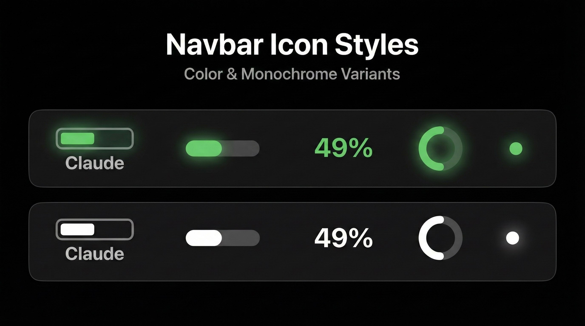
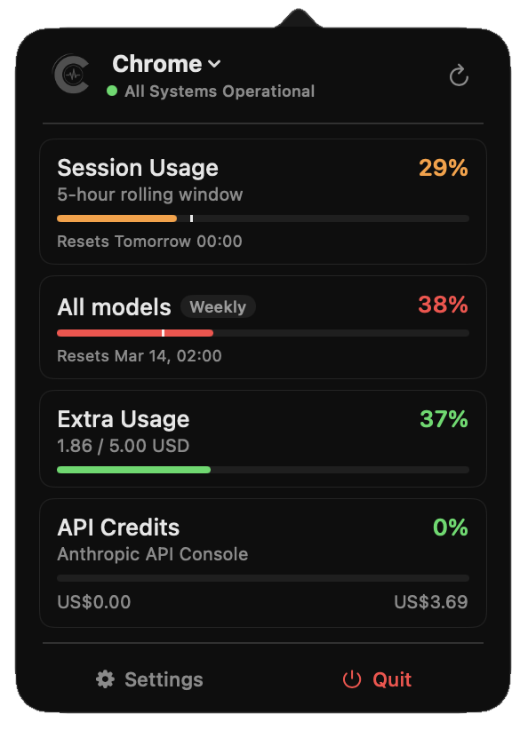

<div align="center">
  <a href="mailto:hamedelfayome@gmail.com?subject=Claude%20Usage%20Tracker%20%E2%80%94%20Sponsorship"></a>
</div>

<br>

<div align="center">
  <a href="https://claudetracker.com/#fleet"></a>

  <a href="https://claudetracker.com"></a>

  <br>

  <a href="https://github.com/hamed-elfayome/Claude-Usage-Tracker/releases/latest/download/Claude-Usage.zip"></a>

  <br>

  <a href="https://www.buymeacoffee.com/hamedelfayome"></a>

   
  <a href="https://claudetracker.com"></a>

</div>

---

**Claude Usage Tracker** is a native macOS menu bar app that shows how much of your Claude limits you have used, and when they reset. It tracks the 5-hour session, the weekly limit, per-model limits and API spend, for as many accounts as you have, and it can do the same for OpenAI Codex.

<div align="center">
  
  
  
</div>

## Install

**Homebrew** (recommended)

```bash
brew install --cask hamed-elfayome/claude-usage/claude-usage-tracker
```

**Direct download:** get [Claude-Usage.zip](https://github.com/hamed-elfayome/Claude-Usage-Tracker/releases/latest/download/Claude-Usage.zip), unzip it, and drag `Claude Usage.app` to Applications.

**Nix:** `nix-shell -p claude-usage-tracker`, or add `claude-usage-tracker` to `home.packages`.

**From source:** clone the repository, open `Claude Usage.xcodeproj` in Xcode, and run.

The app is signed and notarized, needs macOS 13 (Ventura) or later, and updates itself (Settings → Updates). Desktop widgets need macOS 14.

## Get started

Pick whichever fits how you use Claude:

| You have | Do this |
|---|---|
| [Claude Code](https://claude.com/claude-code), logged in | Launch the app. It finds the login on its own. |
| A claude.ai account | Settings → Claude.ai → **Sign in to Claude.ai**, then pick your organization. |
| A session key you'd rather paste | Settings → Claude.ai → **Advanced: Manual Session Key**. |

Click the menu bar icon to see your usage. The [setup guide](docs/setup.md) covers each path step by step, including API Console billing.

The terminal statusline needs a claude.ai sign-in even if the app itself runs on your Claude Code login.

## What it does

**Tracks your limits**
- The 5-hour session, the weekly limit, and per-model weekly limits (Fable, Opus, Sonnet, Design)
- Extra usage and, on Enterprise plans, your own month-to-date spend
- API Console spend, with a daily chart and a per-key breakdown
- Plans without a 5-hour limit (Claude Ultra, Codex Pro) show the week as the main number
- History charts for session, weekly and billing data

**Shows it where you look**
- Menu bar icon in five styles, with separate icons per metric if you want them
- A time marker on every bar: how far through the window you are, colored by projected pace
- Popover with every limit, reset times and Claude's service status
- Six desktop widgets, small to extra large, each with a profile picker
- Used or remaining percentages, three color modes, 15 languages

**Handles several accounts**
- Unlimited profiles, each with its own credentials, appearance and notifications
- Show every profile in the menu bar at once, or only the active one
- OpenAI Codex profiles alongside Claude ones
- Switching profile switches your Claude Code login with it
- `claude-<profile>` terminal commands that always open a given account

**Works with Claude Code**
- A terminal statusline: directory, branch, model, context, usage, pace, reset time, prompt-cache hit rate
- Dynamic Island (beta): what Claude Code is doing, at the notch
- Keep Awake: stops the Mac sleeping while Claude Code works

**Looks after itself**
- Notifications at 75%, 90%, 95% and thresholds you add
- Auto-start a new session when the last one resets
- Auto-switch to the next profile when one hits its session limit
- Global keyboard shortcuts, launch at login, headless Macs supported

## Guides

| Guide | What's in it |
|---|---|
| [Setup](docs/setup.md) | Signing in three ways, API Console billing, where settings live |
| [Profiles](docs/profiles.md) | Multiple accounts, Codex profiles, terminal launchers |
| [Claude Code](docs/claude-code.md) | Statusline setup and components, Dynamic Island, Keep Awake |
| [Widgets](docs/widgets.md) | The six desktop widgets and how to pick a profile |
| [Troubleshooting](docs/troubleshooting.md) | Sign-in errors, missing icon, statusline problems |
| [Adding a provider](docs/ADDING_A_PROVIDER.md) | For contributors: how providers plug in |

## What's new

- **v3.4.0 (2026-11-13)**: **Desktop widgets** — six WidgetKit widgets in small to extra-large sizes with a per-widget profile picker; **Keep Awake** — keeps the Mac awake while Claude Code works; **macOS 13 (Ventura) support**; optional **Fable weekly** metric in the menu bar and statusline (#318, #323); **exclude weekends from weekly pace** (#326); **monthly spend for Enterprise members** (#287); prompt-cache hit rate in the statusline; plans without a 5-hour limit (Claude Ultra, Codex Pro) show weekly as the primary metric (#356); profile switching no longer logs Claude Code out on a dead saved login (#331) and pinned profiles keep their login to themselves (#355); usage history no longer grows without bound (#337); E3006 and 403 sign-in failures fixed (#319, #266); auto-start respects the weekly limit and backs off after failures (#334); macOS 26 material crash fixed (#333); statusline no longer blanks on an old cache (#322); popover percentages say "used" or "remaining" (#269); Persian localization — 15 languages total. Thanks to 15 community contributors.

- **v3.3.0 (2026-08-29)**: **Multi-provider architecture with OpenAI Codex support** (#229) — per-profile provider selection on a registry pattern (`docs/ADDING_A_PROVIDER.md`); **per-profile terminal launchers** — `claude-<profile>` commands with isolated `CLAUDE_CONFIG_DIR` logins and automatic usage tracking after one `/login`; keychain migration finally works on shipped Developer ID builds (#292); popover shows over full-screen apps (#298); Dynamic Island targets the built-in notch (#294); Cloudflare challenges no longer masquerade as expired credentials (#277); macOS 26 multi-profile crash fixes; transient E1000 on profile switch eliminated; obsolete peak-hours indicator removed (#308); Vietnamese localization — 14 languages total. Thanks to 8 community contributors.

Earlier releases are in the [changelog](CHANGELOG.md).

## Privacy and security

- Credentials are stored in the macOS Keychain, never in plain files.
- Usage data stays on your Mac. There is no account and no cloud sync.
- The app talks to claude.ai and Anthropic's API for your usage, over HTTPS only.
- It sends one anonymous heartbeat a day containing the app version, and nothing else.
- The sponsor placement in Settings reads a small JSON file from claudetracker.com, at most every 6 hours, with no cookies or identifiers.
- Updates are delivered over HTTPS and verified by signature.

To report a vulnerability, see [SECURITY.md](SECURITY.md).

## Contributing

Pull requests are welcome. For a larger change, open an issue first so we can agree on the approach. [CONTRIBUTING.md](CONTRIBUTING.md) has the setup, the localization requirement and the conventions.


### Special Thanks

A huge thank you to everyone who contributed code, translations, bug reports, and pull requests. Your effort makes this project possible:

<a href="https://github.com/novastate"></a>
<a href="https://github.com/heathdutton"></a>
<a href="https://github.com/tsvikas"></a>
<a href="https://github.com/kynoptic"></a>
<a href="https://github.com/bezlant"></a>
<a href="https://github.com/trickart"></a>
<a href="https://github.com/Ali-Aldahmani"></a>
<a href="https://github.com/cuvitx"></a>

## License

MIT. See [LICENSE](LICENSE).

This application is not affiliated with, endorsed by, or sponsored by Anthropic PBC. Claude is a trademark of Anthropic PBC. This is an independent third-party tool created for personal usage monitoring.

This project is developed with AI-assisted workflows, primarily Claude Code.

---

<div align="center">
  <sub>Built for the Claude AI community</sub>
</div>
