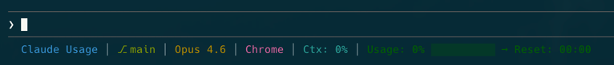

# Claude Code

Three features work with [Claude Code](https://claude.com/claude-code): a statusline in your terminal, the Dynamic Island, and Keep Awake.

## Statusline



### Set it up

You need Claude Code installed and a claude.ai sign-in on the active profile (**Settings → Claude.ai**).

1. Open **Settings → Claude CLI**.
2. Turn on the components you want. The preview shows the result.
3. Click **Apply**.
4. Restart Claude Code.

### Components

| Component | Example |
|---|---|
| Directory | `my-project` |
| Git branch | `⎇ main` |
| Model | `Opus` |
| Profile | `Work` |
| Context window | `Ctx: 48%` or `96K` |
| Session usage | `Usage: 25%` |
| Progress bar | `▓▓░░░░░░░░` |
| Pace marker | `▓▓┃░░░░░░░` |
| Reset time | `→ Reset: 3:45 PM` or `→ 15:45` |
| Weekly usage | `Weekly: 41%` |
| Fable weekly | `Fable: 24%` |
| Extra usage | `9.49 USD` |
| Prompt cache | `⚡ 94% ✗ tools` |

Labels such as `Ctx:` and `Usage:` can be hidden, and the reset time can use the 24-hour clock.

```
my-project │ ⎇ feature/new-ui │ Opus │ Work │ Ctx: 48% │ Usage: 47% ▓▓▓▓┃░░░░░ → Reset: 4:15 PM
```

### Colors

There are three modes: multi-color, greyscale, and a single color of your choice. In multi-color mode you can also set a color per element.

The pace marker shows where you'll end the window if you keep going at the current rate:

| Projected use | Color |
|---|---|
| Under 50% | Green |
| 50–75% | Teal |
| 75–90% | Yellow |
| 90–100% | Orange |
| 100–120% | Red |
| Over 120% | Purple |

### What it installs

- `~/.claude/statusline-command.sh` builds the line.
- `~/.claude/fetch-claude-usage.swift` fetches usage when nothing fresher is available.
- `~/.claude/statusline-config.txt` holds your choices.
- `~/.claude/settings.json` gets a `statusLine` entry. Your other settings are left as they are.

The scripts are readable only by you, because one of them holds your session key.

The app writes a small usage cache on every refresh, and the statusline reads that first. If the cache is more than five minutes old it uses the rate limits Claude Code itself reports, and after that it shows the last reading with its age, for example `(stale 13m)`.

If you edit `statusline-command.sh` by hand, the app saves your version as `statusline-command.sh.backup` before replacing it with a newer shipped script.

### Turn it off

**Settings → Claude CLI → Reset**, then restart Claude Code. This removes the `statusLine` entry and takes the session key out of the script. The app then leaves the script files alone.

## Dynamic Island (beta)

A small display at the notch showing what Claude Code is doing: the current tool, whether it is working or waiting, and a pulse when it needs your input. It handles several sessions at once and expands when clicked.

Turn it on under **Settings → Dynamic Island**. It works through Claude Code hooks that only observe; it can never approve or answer anything for you. On a Mac without a notch it appears as a floating pill.

## Keep Awake

Stops the Mac going to sleep while Claude Code is working.

- **Automatic:** stays awake during active sessions and for a while after they stop (15 minutes by default), then lets the Mac sleep again. Turning it on asks first, because it adds Claude Code hooks to `~/.claude/settings.json`.
- **Manual:** keep the Mac awake for a set time or until you turn it off, from the cup button in the popover or **Settings → Keep Awake**.

By default the display is still allowed to sleep; you can choose to keep it on. With the lid closed the Mac sleeps regardless, unless it is plugged in with an external display.

If automatic mode can't see Claude Code (its hooks are missing, or the local listener's port is taken), the button turns yellow and the settings pane says why.
